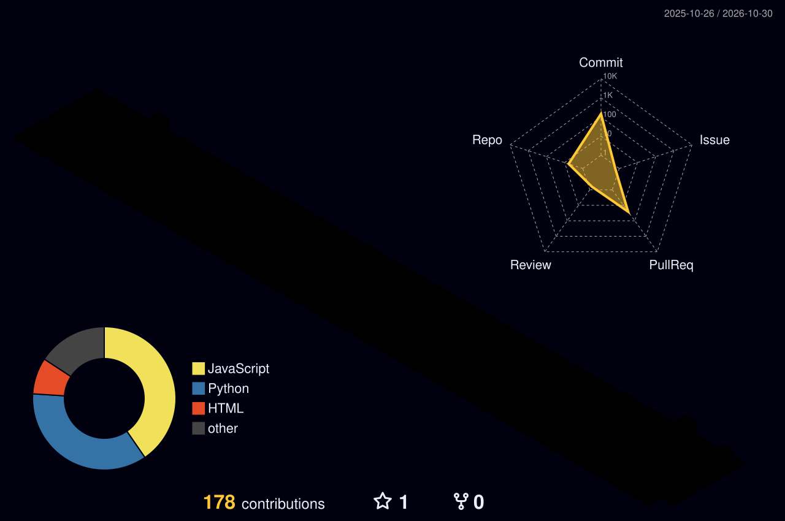

<!-- Header -->

  

  

  
  
  

<!-- Toolbox -->

  

<!-- Projects -->
<h3 align="center">🧪 Research software</h3>

  
  

<!-- Stats -->
<h3 align="center">📊 Stats</h3>

  
  

  

<!-- Contributions -->

  

  <picture>
    <source media="(prefers-color-scheme: dark)" srcset="https://raw.githubusercontent.com/dj-urg/dj-urg/output/github-snake-dark.svg"/>
    
  </picture>

<!-- Footer -->

  

